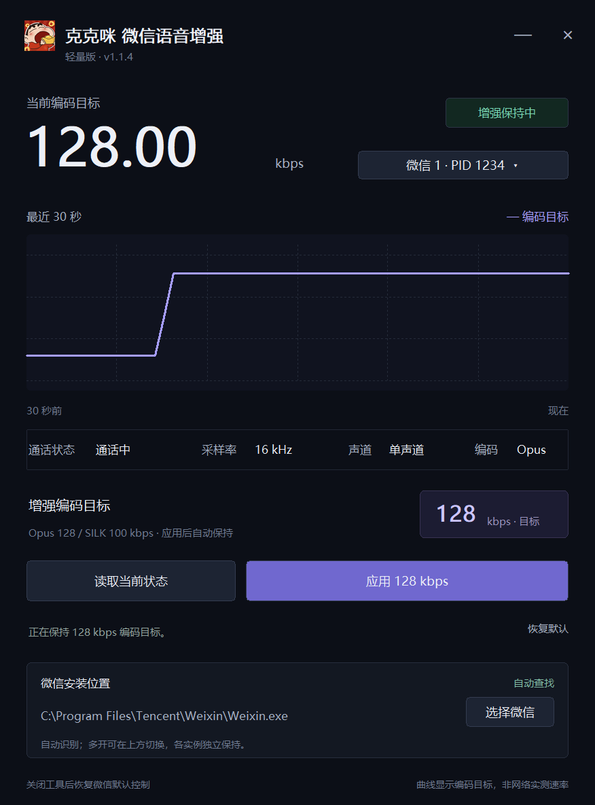

# 克克咪 · 微信语音增强

Windows 轻量工具：单聊 **Opus 128 kbps**，群聊 **SILK 100 kbps**。支持微信多开，各实例独立保持。

**[下载最新版 EXE](https://github.com/kkray983681062-bit/kekemi-wechat-voice-enhancer/releases/latest/download/Kekemi-WeChat-Voice-Enhancer.exe)**

界面使用演示数据。

## 使用

1. 打开电脑微信并接通语音。
2. 多开时在右上方选择微信实例，点击“读取当前状态”，再点击“应用”。
3. 可切换到另一个实例继续应用；切换查看不会停止其他实例的增强。
4. “恢复默认”作用于当前选择的实例；关闭工具停止全部实例的增强。

自动查找并记住安装位置，也能手动选择。支持窗口缩放。无需安装 Python 或 Frida，只需一个 EXE。

按函数特征和对象结构识别，已在微信 **4.2.0.13 x64** 上验证。新通话需重新应用。
曲线显示编码目标，不是网络实测速率；采样率和声道只读。

[使用与构建](docs/guide.md) · [验证范围](native/VALIDATION.md) · [第三方组件](THIRD_PARTY_NOTICES.md) · [反馈问题](https://github.com/kkray983681062-bit/kekemi-wechat-voice-enhancer/issues)
